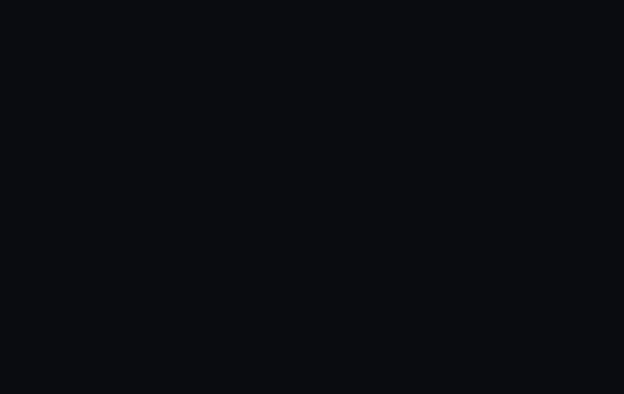

# Redline City

An original open-world crime sandbox for the make.fun gta6-01 competition.

## Play

```bash
node serve.ts
# open http://localhost:8080
```

Or open `game/index.html` directly in a browser (needs a local server for ES modules).

### Controls

| Key / Input | Action |
|-------------|--------|
| WASD / Arrow Keys | Move / Drive |
| Shift | Sprint / Brake |
| Space | Handbrake (vehicle) / Jump (on foot) |
| F | Enter / Exit vehicle |
| Mouse | Aim camera |
| Left Click | Shoot |
| Right Click | Aim down sights |
| R | Reload |
| 1–4 | Switch weapon |
| ESC | Pause / Menu |

### URL Parameters

- `?seed=N` — deterministic world seed (default `123456789`)
- `?shot=start|play|end` — stage a screenshot frame (used for competition screenshots)

## Features

- **Procedural city** — roads, blocks, buildings of varied heights/colours, sidewalks, streetlights, props. Deterministic from a fixed seed.
- **On foot** — walk/run, third-person camera with collision against buildings and props.
- **Vehicles** — 3 visually distinct types (sedan, muscle, SUV), arcade physics (accel, brake, steer, drift), enter/exit parked cars.
- **Traffic** — AI cars drive the road network on lanes, stop for obstacles.
- **Pedestrians** — AI walkers on sidewalks, react to nearby cars and gunfire.
- **Wanted system (1–5 stars)** — police spawn and pursue on crimes (hitting peds, shooting, carjacking), escalation and cooldown.
- **Missions** — 3 chained objectives (Dead Drop → Repossession → Payback) with markers, on-screen text, fail/retry, money rewards.
- **Combat** — hitscan shooting with muzzle flash, tracers, spread, damage, health/armour, wasted screen.
- **HUD** — rotating minimap with blips, wanted stars, health/armour bars, money, weapon/ammo, speedometer, objective banner, crosshair + hit marker.
- **UI** — title screen with controls, pause menu, save/load to localStorage, wasted/mission screens.
- **Audio (WebAudio only)** — engine hum tied to speed, tyre screech, gunshots, siren, ambient city drone, UI clicks. Unlocked on first user gesture.
- **Polish** — lighting and shadows, fog, day tint, screen shake, particles (sparks, smoke, blood), smooth camera lerp.

## Screenshots




## Badge

[](https://make.fun/bounty/gta6-01?utm_source=github&utm_medium=readme&utm_campaign=gta6-01)

## License

MIT